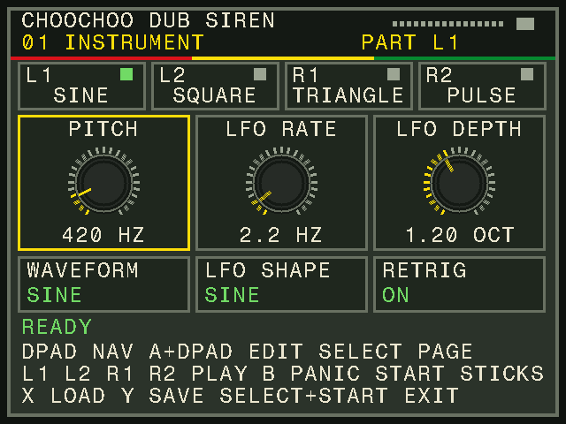
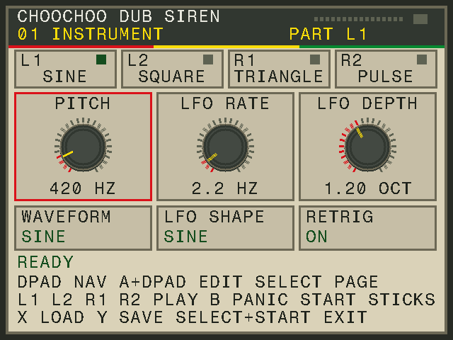
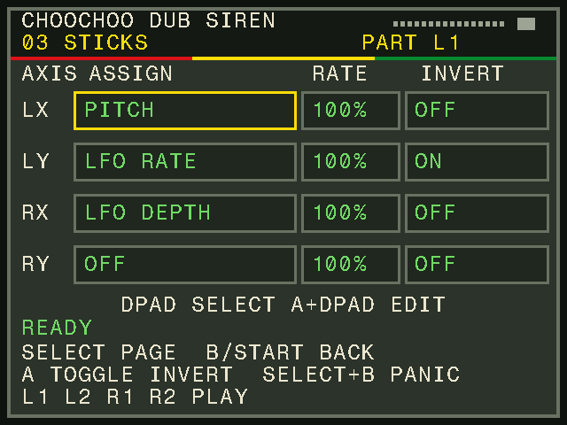

# CHOOCHOO DUB SIREN

**Analog style siren in your handheld console.**

Four sound slots, simple to use, instant playability, designed for live performance.

Sounds good because it's based on the ChooChooTracker engine.

Supports joysticks, touchscreen, and classic Dpad.

[Download a release](https://github.com/paiheulevrai/ChooChooDubSiren/releases) ·
[Controls](#controls) · [Install](#install) · [Build](#build-and-test)

## One siren, four voices

Each trigger — **L1, L2, R1 and R2** — has its own pitch, oscillator waveform,
LFO rate, LFO depth, LFO shape and retrigger setting. Play a trigger to select
its voice, or select a voice with the D-pad.

We've added the ChooChooTracker tape echo effect, in case you don't have a Space Echo sends available on your mixer.  

Not a high-IQ app like ChooChooTracker: it's a simple and fun, yet smooth, instrument.

## Explore the screens

Press **Select** to cycle between the three screens. Both **Day Rastafari** and
**Night Rastafari** themes use the same controls.

### 01 · Instrument

| Day | Night |
|---|---|
|  |  |

Play or select one of the four pads, then shape that voice:

- **PITCH**, **LFO RATE** and **LFO DEPTH** are continuous controls.
- **WAVEFORM** selects sine, triangle, square, saw up, saw down, pulse or
  lo-fi triangle independently for each voice.
- **LFO SHAPE** selects sine, triangle, square, saw up or saw down.
- **RETRIG** determines whether a new trigger press restarts the LFO.

### 02 · Common

| Day | Night |
|---|---|
|  |  |

Set **MASTER VOLUME** and the shared delay's **TIME**, **FEEDBACK**, **MIX**
and **ECHO** send. Choose a **PRESET**, switch the **THEME**, or choose a
**FONT** here. The nine 16×24 fonts include the default and Console, Elektron,
IBM VGA, Camcorder, PSGCapital, C64, Segment and Roboto; the choice is saved.

Four distinct factory presets — **Dub, Reggae, Stepper and Dancehall** — each
provide four voices and shared settings. Four additional user slots can store
your own sounds.

### 03 · Sticks

| Day | Night |
|---|---|
|  |  |

For each axis (**LX, LY, RX, RY**), choose an **ASSIGN** target: off, pitch,
LFO rate or LFO depth. Set its adjustment **RATE** from 10% to 300%, and
toggle **INVERT** as needed. The default mapping is LX pitch, LY LFO rate,
RX LFO depth and RY off; LY is inverted, so pushing it up increases LFO rate.
A dead zone helps prevent accidental adjustments.

## Controls

| Input | Action |
|---|---|
| L1 / L2 / R1 / R2 | Play and select a voice |
| D-pad | Navigate the current screen |
| Select | Next screen |
| Hold A + D-pad | Change the focused setting |
| A on RETRIG, ECHO, THEME or stick INVERT | Toggle |
| A on FONT | Next font (hold A + D-pad for either direction) |
| A on PRESET or X | Load the selected preset |
| Y | Save the selected user preset |
| Select + A on PRESET | Save the selected user preset |
| Start | Open or close stick settings |
| B | Panic: stop the siren and clear the delay |
| Select + Start | Quit |

On the Sticks screen, **B** or **Start** returns to the previous screen;
use **Select + B** for panic. Triggers remain playable on all screens. On
continuous instrument and delay controls, up/down make larger edit steps than
left/right.

### Keyboard

| Console input | Windows key |
|---|---|
| A / B / X / Y | X / Z / S / A |
| L1 / L2 / R1 / R2 | Q / W / R / E |
| D-pad | Arrow keys |
| Start / Select | Space / Left Shift |
| Quit | Escape |

Game controllers are supported on Windows (tested: DualSense)

### Android touch controls

Tap **INST**, **COMMON** or **STICKS** at the top to switch screens directly.
Hold any **L1–R2** pad to play from every screen; drag knobs and stick rates
up or down, and tap the other settings to change them. On Common, tap the
preset arrows to select a slot or the preset name to load it. Tap FONT to
cycle forward; tap its left edge to cycle backward.

The bottom buttons provide **PANIC**, **EXIT**, **LOAD** and **SAVE** without a
gamepad. Save to a user slot; release all held pads before loading a preset.
On wider screens, larger live pads appear beside the instrument controls.

## Install

Download the appropriate archive from the
[Releases page](https://github.com/paiheulevrai/ChooChooDubSiren/releases):

| Platform | Installation |
|---|---|
| **Windows** | Extract the archive and run `DubSiren.exe`, keeping the supplied `SDL2.dll` and `libwinpthread-1.dll` alongside it. |
| **PortMaster** | Copy `ChooChooDubSiren.sh` and the `choochoodubsiren` folder into your console's `ports` directory. Launch from **Ports**. |
| **Miyoo Mini / Mini Plus with OnionOS** | Extract the MiyooPorts archive to the SD card root and launch **ChooChooDubSiren** from Ports. |
| **NextUI** | Install the Pak contents in `Tools/tg5040/ChooChooDubSiren.pak` on the SD card. |
| **Android** | Install `ChooChooDubSiren-Android-touch-preview.apk` on Android 8.0 or later, allowing installation from your chosen source if prompted. The app runs in landscape and supports touch. |

Compatibility and latency vary by hardware and firmware; test your own setup
before playing live.

The Android preview APK is signed with an automatically generated debug key,
not a stable release key. Future builds may require uninstalling it before
installation, which removes its private settings and presets.
The Android GitHub Actions workflow builds the APK and tests it on an emulator.
It can also attach the tested preview to an existing release when manually run.

## Connect safely

Connect the headphone output to a mixer line input using the appropriate
cable. Start with console volume and mixer gain at minimum, then raise them
gradually. Avoid feedback loops and take care with high delay feedback.

Handheld consoles can have a noisy DAC. For best sound quality, maybe you need an audio interface.

Sound test before sending kilowatts of this onto a crowd of innocent people.

## Credits

Inspired by dub siren instruments and sound-system culture. The tape-style
echo draws on ChooChooTracker's Tape Echo; the bundled pixel fonts are also
from [ChooChooTracker](https://github.com/paiheulevrai/Choochootracker).
See `licenses/fonts/README.txt` for font credits and individual licenses, and
`LICENSE.tracker` for the upstream MIT license.

The Miyoo package uses the modified
[SDL2 Miyoo sources](https://github.com/Rparadise-Team/sdl2_miyoo_new) and
runtime libraries from ChooChooTracker; their notices are included in the
package.
