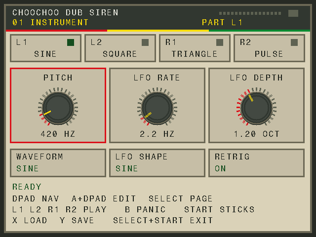

# CHOOCHOO DUB SIREN

**Four voices. One siren. Infinite echoes.**

A hands-on dub siren for handheld consoles and Windows.
Play it live, shape the movement and send it into tape-style delay.

## Play

Hold **L1, L2, R1 or R2** to play and select its voice. Each voice has its
own oscillator waveform, pitch, LFO rate, depth, shape and retrigger setting.
The instrument is monophonic: the most recently pressed trigger takes priority.
When it is released, the previous held trigger resumes.

Press **Select** to cycle through three pages:

1. **Instrument** — select a voice and shape its oscillator and LFO.
2. **Common** — adjust master volume, shared delay, presets and display theme.
3. **Sticks** — assign each joystick axis and set its rate and inversion.

Navigate with the **D-pad**. Hold **A + D-pad** to edit: right/up increases,
left/down decreases. On continuous instrument and delay controls, up/down make
larger steps. Select a voice pad to edit that voice without playing it; playing
a trigger selects its voice too.

With **RETRIG** on, a new trigger press restarts that voice's LFO. Returning to
an already-held trigger does not restart it. The audio oscillator runs freely.
Delay and master volume are common to all four voices, and delay tails continue
after release or after the echo send is turned off.

## Controls

| Input | Action |
|---|---|
| L1 / L2 / R1 / R2 | Play and select a voice |
| D-pad | Navigate the current page |
| Select | Next page |
| Hold A + D-pad | Edit the selected setting |
| A on RETRIG, ECHO, THEME or stick INVERT | Toggle the setting |
| A on PRESET or X | Load the selected preset |
| Y | Save to the selected user preset slot |
| Select + A on PRESET | Save to the selected user preset slot |
| Start | Open or close stick settings |
| B | Panic: stop the siren and clear the delay |
| Select + Start | Quit |

On the stick page, **B** or **Start** returns to the previous page. Use
**Select + B** for panic there. Playing triggers still works on every page.

### Keyboard

| Console input | Windows key |
|---|---|
| A / B / X / Y | X / Z / S / A |
| L1 / L2 / R1 / R2 | Q / W / R / E |
| D-pad | Arrow keys |
| Start / Select | Space / Left Shift |
| Quit | Escape |

SDL-compatible game controllers are supported on Windows.

### Touch and mouse

Tap the page name in the header to change screens. On the instrument page,
hold a voice pad to play it; the **L1 L2 R1 R2** labels at the bottom can be
held on any page. Multiple touches follow the same last-trigger priority as
physical buttons.

Drag a knob upward or downward to adjust it. Tap waveform, LFO shape, switches,
theme and joystick assignment/invert to change them; drag joystick RATE to
adjust its speed. On the common page, tap **<** or **>** to choose a preset
and its name to load it. Tap **X LOAD**, **Y SAVE** or **B PANIC** in the
footer for those actions. The mouse follows the same interactions.

## Shape your sound

**Oscillator:** choose sine, triangle, square, saw up, saw down, pulse or lo-fi
triangle independently for each voice. Select a voice's pad and edit its
waveform there, or use the **WAVEFORM** control.

**LFO:** set rate, depth and shape for each voice. Use retrigger to decide
whether a new press restarts its modulation.

**Delay:** adjust time, feedback and mix on the common page. ECHO controls the
send; existing repeats remain audible when the send is turned off.

**Joysticks:** select an axis and its **ASSIGN**, **RATE** or **INVERT** field.
Use **A + D-pad** to edit; **A** also toggles INVERT. Rate sets adjustment
speed from 10% to 300%. The axes edit the selected voice, not the shared
delay or volume. Defaults are LX pitch, LY LFO rate, RX LFO depth and RY off;
LY is inverted, so pushing it up increases the LFO rate. A dead zone helps
prevent accidental changes.

**Themes:** choose **DAY RASTAFARI** or **NIGHT RASTAFARI** on the common page.
The illuminated rings and knob notches run from 7 o'clock at minimum to
5 o'clock at maximum.

## Presets and settings

The four factory presets are **DUB**, **REGGAE**, **STEPPER** and
**DANCEHALL**. Each contains four voices and shared settings. Four additional
user slots let you save your own sounds:

1. On the common page, select **PRESET** and use **A + D-pad** to choose a slot.
2. Press **A** or **X** to load it, or **Y** to save to a user slot.
3. Release all triggers before loading. Loading a preset does not clear
   existing delay tails.

Older user presets are still readable: previously shared pitch and LFO
settings are copied to all voices, with waveform assignments preserved.
The oldest format assigns its selectable waveform to R1. A preset is rewritten
in the new format only when saved. Older joystick assignments to shared volume
or delay are disabled and reported; choose a new assignment to save it.

Presets, joystick settings and the theme are stored locally. Back up your user
data before replacing or removing an installation.

## Install

Download a build from the repository's Releases page.

- **Windows:** extract the archive and run `DubSiren.exe` with the supplied
  `SDL2.dll` and `libwinpthread-1.dll` alongside it.
- **PortMaster:** install `ChooChooDubSiren.sh` and the `choochoodubsiren`
  folder under your console's `ports` directory. Launch it from **Ports**.
- **Miyoo Mini / Mini Plus with OnionOS:** extract the MiyooPorts archive to
  the SD card root and launch **ChooChooDubSiren** from Ports.
- **NextUI:** install the Pak contents in
  `Tools/tg5040/ChooChooDubSiren.pak` on the SD card.

On handhelds, settings are stored under the installation's `userdata` directory.
On Windows, they are stored in the SDL user-data directory. Compatibility and
latency vary by hardware and firmware; test your own setup before playing live.

## Connect safely

Connect the headphone output to a mixer line input using the appropriate cable.
Start with both console volume and mixer gain at minimum, then raise them
gradually. Avoid feedback loops and take care with high delay feedback.

The software limits its output, but it **cannot guarantee protection** for your
hearing, mixer or speakers. Always check levels before using a sound system.

## Build and test

The application is written in C++17 and uses SDL2.

| Target | Command / requirements |
|---|---|
| Windows | Run `scripts\build-windows.ps1` with MSYS2 UCRT64 and SDL2 installed. Output: `build\windows-release`. |
| Linux | Run `make`, then `make test` for the focused audio and application tests. |
| ARM64 | Use the ARM64 cross-compiler and SDL2 development libraries, then run `scripts/package-arm.sh` from Linux or WSL. |
| MiyooPorts | Set `MIYOO_TOOLCHAIN` and `MIYOO_SDL2_ROOT` to the Miyoo ARM toolchain and SDL2 SDK, then run `scripts/package-miyoo.sh` from Linux or WSL. The SDK directory must contain `include`, `lib`, `COPYING.txt` and `MIYOO-LICENSE.txt`. |

GitHub Actions also builds and checks all four distribution packages.

## Credits

Inspired by dub siren instruments and sound-system culture. The tape-style
echo draws on ChooChooTracker's Tape Echo; the bundled pixel font is also
from [ChooChooTracker](https://github.com/paiheulevrai/Choochootracker).
See `LICENSE.tracker` for the upstream MIT license.
The Miyoo package uses the modified [SDL2 Miyoo sources](https://github.com/Rparadise-Team/sdl2_miyoo_new)
and runtime libraries from ChooChooTracker; their notices are included in the package.
