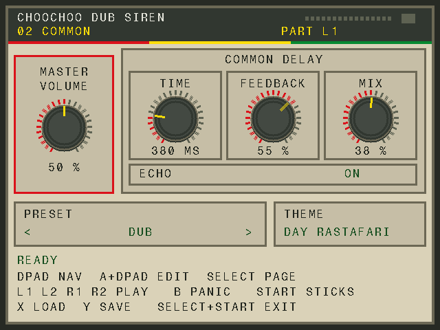
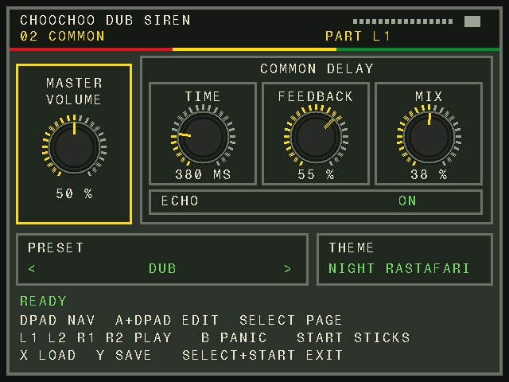
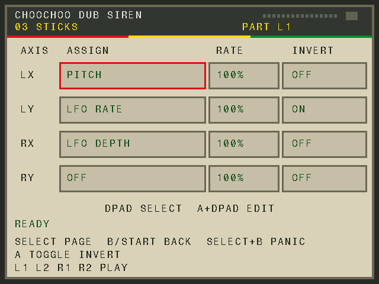

# CHOOCHOO DUB SIREN

**Four voices. One siren. Infinite echoes.**

A playable dub siren for handhelds and Windows: four individually shaped
voices, live joystick modulation and a shared tape-style delay.

[Download a release](https://github.com/paiheulevrai/ChooChooDubSiren/releases) ·
[Controls](#controls) · [Install](#install) · [Build](#build-and-test)

## One siren, four voices

Each trigger — **L1, L2, R1 and R2** — has its own pitch, oscillator waveform,
LFO rate, LFO depth, LFO shape and retrigger setting. Play a trigger to select
its voice, or select a voice with the D-pad without playing it. The joysticks
edit the currently selected voice.

The siren is **monophonic**, not a four-note synthesizer: the last trigger
pressed takes priority. When it is released, the previous held trigger resumes.
If RETRIG is enabled, a new press restarts that voice's LFO; resuming an
already-held trigger does not. The oscillator itself runs freely.

Master volume and delay are shared. Turning ECHO off stops new sound entering
the delay, while existing repeats continue.

## Explore the screens

Press **Select** to cycle between the three screens. Both **Day Rastafari** and
**Night Rastafari** themes use the same controls.

### 01 · Instrument

| Day Rastafari | Night Rastafari |
|---|---|
|  |  |

Play or select one of the four pads, then shape that voice:

- **PITCH**, **LFO RATE** and **LFO DEPTH** are continuous controls.
- **WAVEFORM** selects sine, triangle, square, saw up, saw down, pulse or
  lo-fi triangle independently for each voice.
- **LFO SHAPE** selects sine, triangle, square, saw up or saw down.
- **RETRIG** determines whether a new trigger press restarts the LFO.

The illuminated rings and knob notches travel from **7 o'clock** at minimum to
**5 o'clock** at maximum.

### 02 · Common

| Day Rastafari | Night Rastafari |
|---|---|
|  |  |

Set **MASTER VOLUME** and the shared delay's **TIME**, **FEEDBACK**, **MIX**
and **ECHO** send. Choose a **PRESET** or switch the **THEME** here.

Four distinct factory presets — **Dub, Reggae, Stepper and Dancehall** — each
provide four voices and shared settings. Four additional user slots can store
your own sounds.

### 03 · Sticks

| Day Rastafari | Night Rastafari |
|---|---|
|  |  |

For each axis (**LX, LY, RX, RY**), choose an **ASSIGN** target: off, pitch,
LFO rate or LFO depth. Set its adjustment **RATE** from 10% to 300%, and
toggle **INVERT** as needed. The default mapping is LX pitch, LY LFO rate,
RX LFO depth and RY off; LY is inverted, so pushing it up increases LFO rate.
A dead zone helps prevent accidental adjustments.

## Controls

| Input | Action |
|---|---|
| L1 / L2 / R1 / R2 | Play and select a voice |
| D-pad | Navigate the current screen |
| Select | Next screen |
| Hold A + D-pad | Change the focused setting |
| A on RETRIG, ECHO, THEME or stick INVERT | Toggle |
| A on PRESET or X | Load the selected preset |
| Y | Save the selected user preset |
| Select + A on PRESET | Save the selected user preset |
| Start | Open or close stick settings |
| B | Panic: stop the siren and clear the delay |
| Select + Start | Quit |

On the Sticks screen, **B** or **Start** returns to the previous screen;
use **Select + B** for panic. Triggers remain playable on all screens. On
continuous instrument and delay controls, up/down make larger edit steps than
left/right.

### Keyboard

| Console input | Windows key |
|---|---|
| A / B / X / Y | X / Z / S / A |
| L1 / L2 / R1 / R2 | Q / W / R / E |
| D-pad | Arrow keys |
| Start / Select | Space / Left Shift |
| Quit | Escape |

SDL-compatible game controllers are supported on Windows.

### Touch and mouse

Tap the screen name in the header to change screens. Hold an instrument pad
to play it, or hold the **L1 L2 R1 R2** labels at the bottom of any screen.
Multiple touches follow the same last-trigger priority as physical buttons.

Drag a knob up or down to adjust it. Tap waveform, LFO shape, switches, theme
and joystick assignment/invert to change them; drag joystick RATE to adjust
its speed. On Common, tap **<** or **>** to choose a preset and its name to
load it. Tap **X LOAD**, **Y SAVE** or **B PANIC** in the footer for those
actions. The mouse follows the same interactions.

## Presets and data

1. On Common, focus **PRESET** and use **A + D-pad** to choose a slot.
2. Press **A** or **X** to load it, or **Y** to save to a user slot.
3. Release all triggers before loading. Loading does not clear delay tails.

Older user presets remain readable: previously shared pitch and LFO settings
are copied to all voices, with waveform assignments preserved. The oldest
format assigns its selectable waveform to R1. A preset is rewritten in the
new format only when saved. Older joystick assignments to shared volume or
delay are disabled and reported; choose a new assignment to save it.

On handhelds, presets, stick settings and theme are stored in the
installation's `userdata` directory; on Windows they use the SDL user-data
directory. Back up your data before replacing or removing an installation.

## Install

Download the appropriate archive from the
[Releases page](https://github.com/paiheulevrai/ChooChooDubSiren/releases):

| Platform | Installation |
|---|---|
| **Windows** | Extract the archive and run `DubSiren.exe`, keeping the supplied `SDL2.dll` and `libwinpthread-1.dll` alongside it. |
| **PortMaster** | Copy `ChooChooDubSiren.sh` and the `choochoodubsiren` folder into your console's `ports` directory. Launch from **Ports**. |
| **Miyoo Mini / Mini Plus with OnionOS** | Extract the MiyooPorts archive to the SD card root and launch **ChooChooDubSiren** from Ports. |
| **NextUI** | Install the Pak contents in `Tools/tg5040/ChooChooDubSiren.pak` on the SD card. |

Compatibility and latency vary by hardware and firmware; test your own setup
before playing live.

## Connect safely

Connect the headphone output to a mixer line input using the appropriate
cable. Start with console volume and mixer gain at minimum, then raise them
gradually. Avoid feedback loops and take care with high delay feedback.

The software limits its output, but it **cannot guarantee protection** for
your hearing, mixer or speakers. Always check levels before using a sound
system.

## Build and test

The application is written in C++17 and uses SDL2.

| Target | Command / requirements |
|---|---|
| Windows | Run `scripts\build-windows.ps1` with MSYS2 UCRT64 and SDL2 installed. Output: `build\windows-release`. |
| Linux | Run `make`, then `make test` for the focused audio and application tests. |
| ARM64 | Use the ARM64 cross-compiler and SDL2 development libraries, then run `scripts/package-arm.sh` from Linux or WSL. |
| MiyooPorts | Set `MIYOO_TOOLCHAIN` and `MIYOO_SDL2_ROOT` to the Miyoo ARM toolchain and SDL2 SDK, then run `scripts/package-miyoo.sh` from Linux or WSL. The SDK directory must contain `include`, `lib`, `COPYING.txt` and `MIYOO-LICENSE.txt`. |

GitHub Actions also builds and checks all four distribution packages.

## Credits

Inspired by dub siren instruments and sound-system culture. The tape-style
echo draws on ChooChooTracker's Tape Echo; the bundled pixel font is also
from [ChooChooTracker](https://github.com/paiheulevrai/Choochootracker).
See `LICENSE.tracker` for the upstream MIT license.

The Miyoo package uses the modified
[SDL2 Miyoo sources](https://github.com/Rparadise-Team/sdl2_miyoo_new) and
runtime libraries from ChooChooTracker; their notices are included in the
package.
